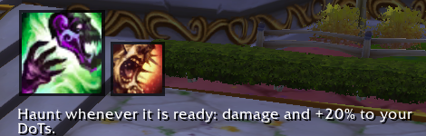
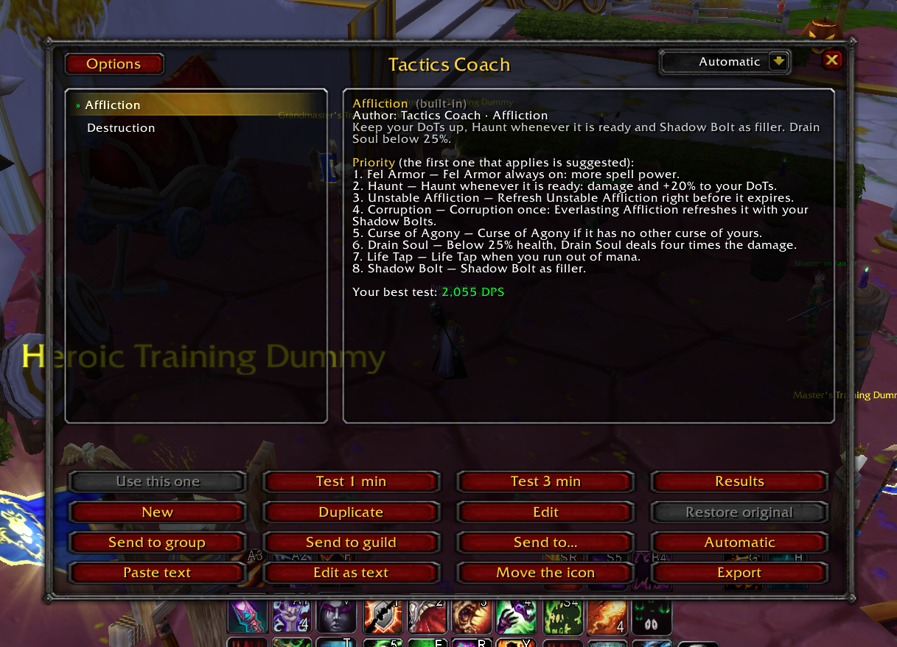
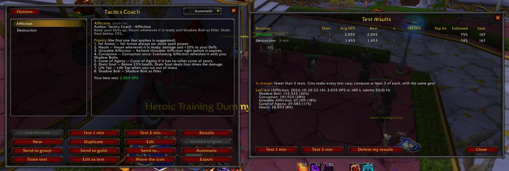
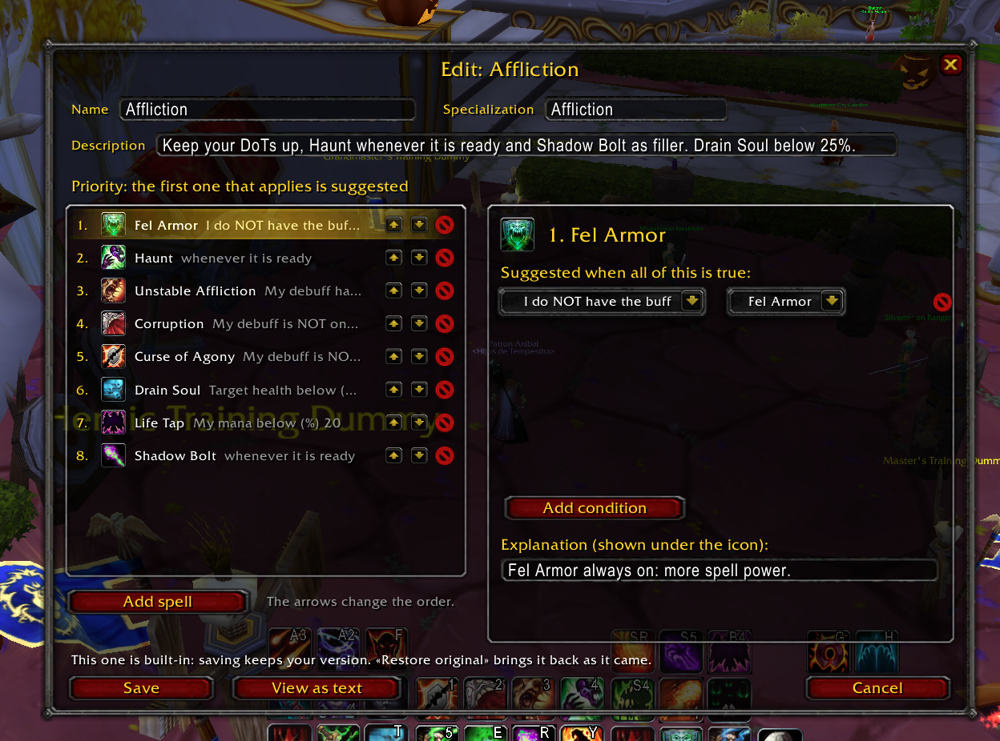
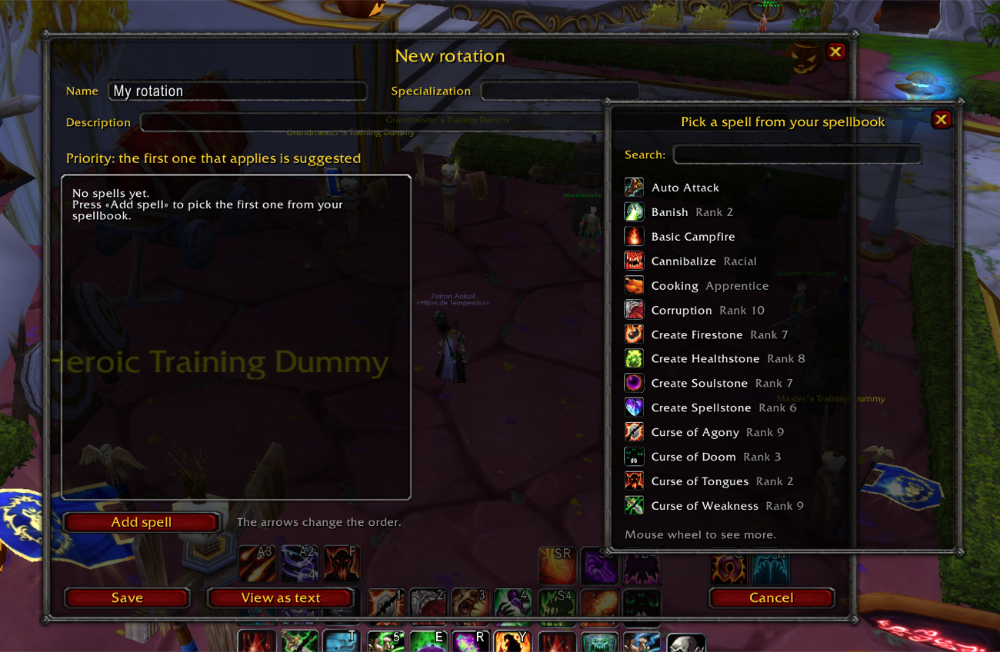
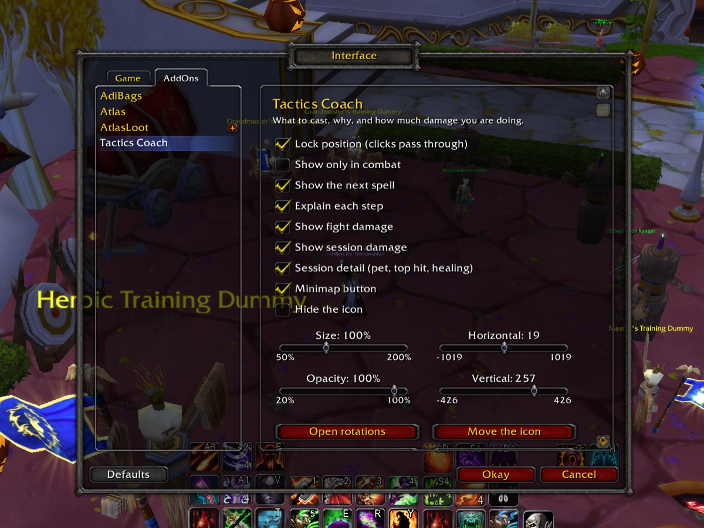

<div align="center">

# 🎯 Tactics Coach

**Learn your class. Prove it on the dummy.**

Tactics Coach tells you which spell to cast now and why, lets you build and share your own rotations, and measures on a training dummy which one deals more damage.

-8a2be2)


*[Leer en español](README.es.md)*

</div>

---

A rotation guide tells you *what* to press. Tactics Coach sits next to your action bars and tells you **what to press right now** — and **why** — so you learn the priority instead of memorizing it. Then it lets you put that priority to the test: run a 1 or 3 minute test on a training dummy and compare rotations side by side.

<p align="center">
  
</p>
<p align="center"><sub>The spell to cast now, the one after it, and <b>why</b>.</sub></p>

<p align="center">
  
  
</p>
<p align="center"><sub><b>Rotations</b> — every step of the priority, explained &nbsp;·&nbsp; <b>Results</b> — compare rotations on the dummy</sub></p>

## ✨ Features

| | What | How |
|---|---|---|
| 🎯 | **What to cast now** | A big icon with the next spell, a small one with the spell after it, and the explanation of the step. Bluish when you are waiting for mana/energy, reddish when out of range |
| 📚 | **Templates for all 10 classes** | PvE and PvP rotations based on the 3.3.5a meta (ICC and Season 8). Picked automatically from your talents |
| 🛠️ | **Visual editor** | Pick spells from your spellbook, order them, and add conditions from a menu — no code. Built-in rotations can be edited and restored |
| ⏱️ | **1 and 3 minute tests** | DPS, damage per spell, **pet DPS** apart, **top hit**, **healing**, and how often you **followed** the suggestion. Only tests of the same length are compared |
| 📊 | **Session meter** | Damage and DPS of the current fight and the whole session, pet share, top hit and healing — under the icon and on the minimap button |
| 🤝 | **Share** | Send a rotation to your group, guild or a friend in game, or export it as text for Discord. English and Spanish rotations work in either client |
| 🌍 | **English and Spanish** | Follows your client (`esES` / `esMX`), or pick a language yourself |

## 📚 Built-in templates

| Class | PvE | PvP |
|---|---|---|
| **Death Knight** | Frost, Unholy, Blood Tank | Unholy |
| **Druid** | Balance, Feral Cat, Feral Tank (Bear), Restoration | Feral, Restoration |
| **Hunter** | Marksmanship, Survival, Beast Mastery | Marksmanship, Beast Mastery |
| **Mage** | Arcane, Fire | Frost |
| **Paladin** | Retribution, Protection, Holy | Retribution, Holy |
| **Priest** | Shadow, Discipline, Holy | Discipline, Shadow |
| **Rogue** | Subtlety, Assassination, Combat | Subtlety, Assassination |
| **Shaman** | Elemental, Enhancement, Restoration | Restoration, Enhancement, Elemental |
| **Warlock** | Affliction, Destruction, Demonology | Affliction, Destruction |
| **Warrior** | Fury, Arms, Protection | Arms |

Each one explains every step, so you can read *why* a spell sits where it sits. They are a starting point: duplicate one and tune it for your gear, your talents and your fight.

## 🚀 Quick start

1. Download **`TacticsCoach.zip`** from the [latest release](../../releases/latest) and extract it into `World of Warcraft/Interface/AddOns/`. You should end up with `Interface/AddOns/TacticsCoach/TacticsCoach.toc`.
2. Log in. Your rotation is picked from the talent tree where you have the most points. Open the addon with **`/tc`** or the minimap button.
3. Find a training dummy and press **Test 3 min**. Then **Results** to compare.

> Tip: type `/console scriptErrors 1` once. WoW 3.3.5a hides Lua errors by default — if something ever looks wrong, the error tells us exactly what.

## 🛠️ Build your own rotation

In `/tc`: **New**, **Duplicate** or **Edit** (built-in ones too — **Restore original** brings them back).

<p align="center">
  
  
</p>

1. **Add spell** opens your spellbook with a search box.
2. The list on the left is the priority: most important on top. Arrows reorder, the X removes.
3. Click a spell to give it **conditions** from a menu ("My debuff has less than 3 sec.", "Target health below 25%", "Target is casting"…). All of them must be true. No conditions: suggested whenever it is ready.
4. Write the **explanation** you want to see under the icon, and **Save**.

You never need to check that a spell is ready or known: if it is on cooldown, not learned, or not usable right now (wrong stance or form, no proc), it is skipped.

### As text

Under the hood a rotation is plain text — that is what you export and share. **Edit as text** and **Paste text** let you write it by hand:

```
rotation: Destruction with Agony
class: WARLOCK
tree: 3
spell immolate = 47811
spell agony = 47864
spell incinerate = 47838
action immolate if debuff.immolate.remains < cast.immolate -- Keep Immolate up.
action agony if debuff.agony.down
action incinerate -- Filler.
```

Conditions are a small, closed language: they can only read the values below, never run code, so a rotation someone shares with you is safe to import.

| Write | Meaning |
|---|---|
| `buff.X.up` / `.down` / `.remains` / `.stack` | Your buff X |
| `debuff.X.…` | **Your** debuff on the target |
| `target_buff.X.…` | **Your** buff on the target (HoTs, shields, Beacon) |
| `self_debuff.X.…` | A debuff on you (Arcane Blast stacks, Forbearance) |
| `cooldown.X.ready` / `.remains` | Cooldown, ignoring the global cooldown |
| `cast.X` | Cast time of X, with haste |
| `mana`, `health`, `target.health` | Percentages |
| `target.casting`, `target.player`, `target.friendly` | True or false |
| `energy`, `rage`, `runic_power`, `combo_points`, `soul_shards` | Resources |
| `stealthed`, `combat`, `moving`, `pet` | True or false |

Combine with `and`, `or`, `not`, parentheses and `< <= > >= == !=`. The Spanish words work too (`perjuicio`, `beneficio`, `y`, `o`, `si`…). `/tc id <name>` gives your spell ids and `/tc auras` the ids of the auras you have.

## ⌨️ Commands

| Command | |
|---|---|
| `/tc` | Open your rotations |
| `/tc test [seconds]` · `/tc stop` · `/tc results` | Dummy tests |
| `/tc move` · `/tc lock` · `/tc unlock` | Place the icon (right-click to finish moving) |
| `/tc options` | Options (also in *Interface → AddOns*) |
| `/tc reset` | Reset the session meter |
| `/tc language auto\|en\|es` | Language |
| `/tc id <text>` · `/tc auras` | Spell and aura ids, for writing rotations by hand |

Every command also works in Spanish (`/tc prueba`, `/tc mover`, `/tc idioma`…).

<p align="center">
  
</p>

## ❓ FAQ

**Does it cast for me?** No. Blizzard does not let addons cast spells — and the point is that *you* learn the rotation. It suggests; you press.

**Is it a full combat simulator?** No. It is a priority list read every tenth of a second. It cannot see your teammates' cooldowns or count targets, and it suggests one thing at a time. It is a coach, not a bot.

**Healers?** The suggestion is about your **current target**: select the ally you heal.

**Where is my data?** In `WTF/Account/<ACCOUNT>/SavedVariables/TacticsCoach.lua` (rotations and tests) and the per-character file (selected rotation and session meter).

## 🏰 Made for Stormrage

Tactics Coach was made for the [Stormrage](https://stormrage-server.com) WotLK realm — where training dummies also raise your weapon skills — but it works on any 3.3.5a client.

## 📜 License

[GNU GPL v3](LICENSE). Contributions welcome: new templates, fixes to existing priorities, translations.
